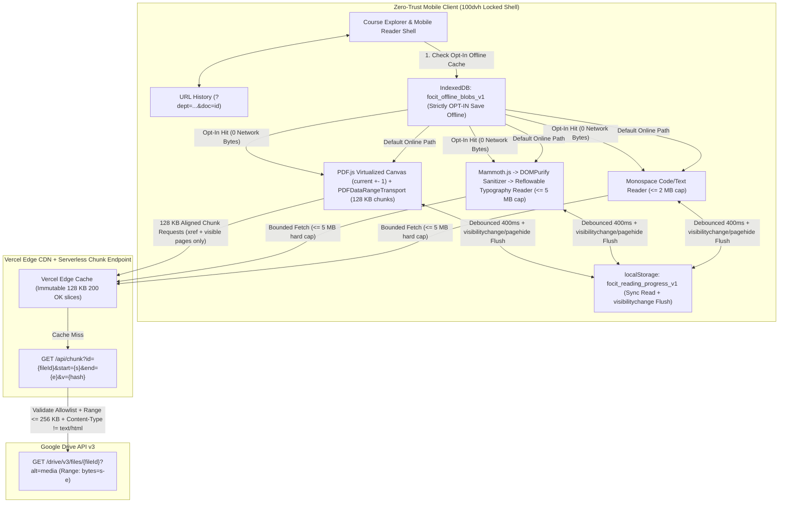

# FOCITSA Knowledge Base — Mobile-First Document Reader & Course Architecture Plan (v2 — Hardened)

> [!IMPORTANT]
> **Architectural Revision Note (v2):**
> This revision resolves all critical blockers identified during the Staff Architecture review:
> 1. **Eliminated Unbounded Payload Buffering:** Replaced full-file `PROXY -> IDB_BLOB -> PDF_ENG` buffering with **strictly bounded `128 KB` chunked Range fetching (`PDFDataRangeTransport`)** (`disableAutoFetch: true`, `disableStream: true`). IndexedDB offline caching is now **strictly opt-in**.
> 2. **Solved Vercel Hobby Payload/Timeout/ENOENT Constraints:** Hard-capped proxy chunk responses at `256 KB` (well under Vercel's `4.5 MB` limit), aligned chunks to deterministic cacheable `128 KB` boundaries (`200 OK` + immutable CDN caching), bundled `manifest.json` statically at module init, and documented a **Zero-Vercel-Bandwidth** direct Drive API v3 option.
> 3. **Eliminated Broken `.PPT`/`.PPTX` Runtime Export & `&confirm=t` Fragility:** Restricted Drive `/export` exclusively to native Google Workspace MIME types, switched upstream transport to official Google Drive API v3 (`?alt=media`) with strict `Content-Type` HTML-interstitial rejection, and separated binary `.ppt`/`.pptx` into an explicit architectural choice (Build-Time LibreOffice vs. Clean Degraded Slide Card).
> 4. **Closed Security & Viewport Invariants:** Added vendored **DOMPurify** sanitization for all Mammoth.js `.docx` HTML output, enforced **`100dvh` + `contain: layout paint` + `overscroll-behavior: contain`** on the reader shell and bottom-sheet drawer, and confined `GENERAL` filename-to-course inference strictly to build time (`scripts/crawl-drive.js`).

---

## 1. Repository Reality Check (Measured from `public/manifest.json`)

| Format | Count | Max File Size | Total Size | Mobile Rendering Strategy |
| :--- | :---: | :---: | :---: | :--- |
| **PDF** | 43 | `37.87 MB` | `177.40 MB` | Virtualized PDF.js canvas + `128 KB` sparse chunk transport (`PDFDataRangeTransport`) |
| **DOCX** | 5 | `0.88 MB` | `0.97 MB` | Mammoth.js reflowable HTML $\rightarrow$ **DOMPurify** strict sanitization $\rightarrow$ mobile typography shell |
| **PPTX / PPT** | 4 (`3` + `1`) | `1.33 MB` | `2.64 MB` | **Requires Decision (Section 6):** Build-time LibreOffice PDF conversion *or* Degraded Slide Card |
| **TXT** | 1 | `1.06 KB` | `1.06 KB` | Native UTF-8 monospace reader with word-wrap & font scaling |
| **Total** | **53** | **`37.87 MB`** | **`181.01 MB`** | — |

---

## 2. Target System Architecture (Zero-Buffering Sparse Transport)



---

## 3. Component Design & Hard Invariants

### Component 1: Bounded Chunk Proxy (`api/chunk.js`) & Bandwidth Survival

To guarantee zero Vercel `4.5 MB` payload failures, zero 3G timeouts, and minimal Vercel Fast Data Transfer consumption:

1. **Module-Scope Allowlist (Zero `ENOENT`, Zero Per-Request Parsing):**
   - `api/chunk.js` statically imports `public/manifest.json` once at module load (`const manifest = require('../public/manifest.json')`) **and** declares `"functions": { "api/chunk.js": { "includeFiles": "public/manifest.json" } }` in `vercel.json`.
   - Builds an immutable `const ALLOWED_FILES = new Map(manifest.map(item => [item.fileId, item]))` at cold start. Any `id` not in `ALLOWED_FILES` receives `403 Forbidden` immediately (prevents open-proxy abuse).
2. **Hard Payload Cap (`MAX_CHUNK_BYTES = 262144` / 256 KB) & Aligned `128 KB` Slices:**
   - Every PDF request from our custom `PDFDataRangeTransport` requests deterministic, `128 KB`-aligned byte ranges:
     `GET /api/chunk?id={fileId}&start={0|131072|...}&end={131071|262143|...}&v={manifestModifiedEpoch}`
   - If `end - start + 1 > 262144` (or `start < 0` or `end < start`), `/api/chunk` rejects with `416 Range Not Satisfiable` / `400 Bad Request`.
   - Because each chunk URL has deterministic query params (`id`, `start`, `end`, `v`) and returns `200 OK` (with `Content-Type: application/octet-stream`, `X-Content-Range: bytes start-end/total`, and `Cache-Control: public, max-age=31536000, s-maxage=2592000, immutable`), **both the browser HTTP cache and Vercel's Edge CDN cache individual `128 KB` slices reliably** (avoiding CDN inconsistency with `206 Partial Content` cache keys).
   - For small non-PDF inline documents (`DOCX`, `TXT`, `MD` strictly `< 4 MB`), `/api/chunk?id={fileId}&mode=full&v={epoch}` streams the complete file only if `manifestEntry.fileSize <= 4 * 1024 * 1024`; otherwise returns `413 Payload Too Large` forcing range mode or direct download.
3. **Official Drive API v3 Upstream + HTML Interstitial Sniffing:**
   - **Primary Upstream:** Calls `https://www.googleapis.com/drive/v3/files/${fileId}?alt=media&supportsAllDrives=true` with header `Range: bytes=${start}-${end}` and `signal: AbortSignal.timeout(8000)` authenticated via:
     - **`GOOGLE_DRIVE_API_KEY` (Preferred for public Drive files):** Avoids cold-start OAuth2 JWT token-exchange round trips on Vercel Hobby containers.
     - **`GOOGLE_SA_KEY` (Fallback for private/restricted files):** Mints and caches an OAuth2 access token in module memory for 50 minutes.
   - **Upstream Timeout Guard:** If Google Drive stalls past `8000ms` (`TimeoutError`/`AbortError`), `/api/chunk` returns a structured `504 Gateway Timeout` JSON response (`{ error: 'UPSTREAM_TIMEOUT', retryable: true }`, `Cache-Control: no-store`) so the reader's Retry card triggers cleanly before Vercel hard-kills the function at `10s`.
   - **Native Google Workspace Docs ONLY:** If `manifestEntry.mimeType` starts with `application/vnd.google-apps.` (e.g. `GDOC`, `GSLIDES`), calls Drive API v3 `/export?mimeType=application/pdf`. **Never** calls `/export` on binary `.ppt`/`.pptx`/`.docx`.
   - **Strict `Content-Type` Guard:** Before forwarding a single byte to the client, `/api/chunk` inspects the upstream response's `Content-Type` and HTTP status:
     - If upstream returns `text/html` (Google virus-scan warning page, permission interstitial, or 404 HTML) or status outside `[200, 206]`, `/api/chunk` immediately returns `502 Bad Gateway` with JSON `{ error: 'UPSTREAM_HTML_INTERSTITIAL', retryable: true }` and `Cache-Control: no-store`. PDF.js never receives garbage HTML.
4. **Exam-Week Bandwidth & Timeout Math (200 Students on 39.7 MB Textbook):**
   - **Timeout Survival:** Each `128 KB` chunk takes `~2.5s` on slow 3G (`400 Kbps`) — well under Vercel Hobby's function timeout. And once any student requests pages 1–10, subsequent students hit **Vercel Edge CDN cache** (`0` function invocations, `<50ms` TTFB).
   - **Bandwidth Survival:** Because PDF.js uses `disableAutoFetch: true` + `disableStream: true` + `PDFDataRangeTransport`, opening a `39.7 MB` textbook downloads only the trailer/xref (`~128 KB`) + the pages actually viewed (`~1 MB` for 8–12 pages).
     - **200 students $\times$ ~1.2 MB = `240 MB`** (instead of `8,000 MB` — a **97% reduction**). At `1.2 MB` per reading session, Vercel Hobby's `100 GB/month` Fast Data Transfer supports **~83,000 reading sessions/month**.

---

### Component 2: Format-Aware Mobile Document Reader & Security Invariants

1. **Physical Viewport Lock (Invariant #1 — Zero Layout Shift on Mobile):**
   - `<dialog id="reader-dialog">` uses:
     ```css
     .reader-dialog {
       width: 100vw;
       height: 100dvh;
       max-width: 100vw;
       max-height: 100dvh;
       margin: 0;
       padding: 0;
       border: none;
       overflow: hidden;
       contain: layout paint;
       display: flex;
       flex-direction: column;
     }
     ```
   - The top toolbar and bottom page scrubber are flex children (`flex-shrink: 0`), with `padding-bottom: max(8px, env(safe-area-inset-bottom))` on the scrubber — **never `position: fixed` against `100vh`**. The document viewport is the sole internal scroll container (`flex: 1; min-height: 0; overflow-y: auto; overscroll-behavior: contain;`). Retracting mobile browser chrome never causes the scrubber to jump or trigger CLS.
   - The mobile **Bottom-Sheet Filter Drawer** (`<dialog id="mobile-filter-sheet">`) similarly enforces `max-height: 85dvh; contain: layout paint; overscroll-behavior: contain;`.

2. **Format-Specific Renderers (Vendored Locally in `public/assets/vendor/` — Zero External CDN SPOF):**
   - **PDF (`pdf.min.js` + `pdf.worker.min.js`):**
     - Custom `PDFDataRangeTransport(resource.fileSize)` fetches aligned `128 KB` slices on demand with `disableAutoFetch: true`, `disableStream: true`.
     - **Windowed Canvas Virtualization:** `IntersectionObserver` allocates `<canvas>` bitmaps **only** for `[currentPage - 1, currentPage, currentPage + 1]` (capped at `Math.min(window.devicePixelRatio, 2)` to protect low-RAM Android GPUs). Off-screen pages retain exact aspect-ratio placeholder divs (`data-page="N"`), keeping mobile canvas memory `< 18 MB` even on a 1,009-page textbook.
     - Mobile controls: **Fit-to-Width / Zoom (`75%–200%`)**, **Reading Theme (`Light`, `Sepia`, `Dark` via CSS filter inversion on canvas)**, **Page Scrubber + Jump-to-Page input**.
   - **DOCX (`mammoth.browser.min.js` + `dompurify.min.js`):**
     - Hard client-side guard: rejects files `> 5 MB` before calling `arrayBuffer()` (all 5 current DOCX files are `< 0.9 MB`).
     - Converts binary `.docx` into semantic HTML, then **strictly sanitizes every string via DOMPurify** before DOM insertion:
       ```js
       const cleanHtml = DOMPurify.sanitize(result.value, {
         USE_PROFILES: { html: true },
         FORBID_TAGS: ['script', 'style', 'iframe', 'object', 'embed', 'form', 'input'],
         FORBID_ATTR: ['style', 'onerror', 'onload', 'onclick'],
       });
       ```
     - Reflowable mobile controls: **Font Size (`A-` / `A+`)**, **Font Family (`Sans` / `Serif`)**, **Theme (`Light` / `Sepia` / `Dark`)**, and **TOC / Heading jump**.
   - **TXT / MD (`<= 2 MB` cap):**
     - Decoded via `TextDecoder('utf-8')`, rendered via `textContent` (zero HTML injection surface), with **Word-Wrap toggle**, **Font Size scaling**, and **Copy Text** button.
   - **PPT / PPTX (4 files, `max 1.33 MB`):**
     - **Option A (Build-Time Conversion):** Convert `.ppt`/`.pptx` to PDF in `refresh-manifest.yml` via headless LibreOffice (`soffice --headless --convert-to pdf`) and reference the generated PDF in `manifest.json` so slides open in the native PDF reader with page-by-page progress.
     - **Option B (Clean Degraded Slide Card):** Render a fast mobile Slide Deck card with metadata, 1-tap **Download Slides**, **Mark as Studied** progress toggle, and an opt-in **Fallback Preview** button (no broken runtime Drive export calls).

---

### Component 3: Reading Progress, Tab Suspension Recovery & Opt-In Offline Cache

#### 1. State Hierarchy & Storage Guards
- **URL (`?dept=...&level=...&doc={resourceId}`):** Syncs open document via `history.pushState({ readerOpened: true, doc: resourceId }, '', nextUrl)`. Pressing the Android hardware back button or iOS edge-swipe triggers `popstate` and closes the reader cleanly.
- **`localStorage` (`focit_reading_progress_v1` & `focit_reader_prefs_v1`):**
  - Every `getItem` / `setItem` is wrapped in `try/catch` to survive Safari Private Mode and `QuotaExceededError` without throwing unhandled exceptions.
  - Progress schema: `{ resourceId, fileId, courseCode, title, fileExt, unit: 'page' | 'percent' | 'status', current, total, percent, completed, updatedAt }`.
  - **Persistence Triggers:** Debounced `400ms` during scrolling/paging **PLUS** synchronous flush on `visibilitychange` (`document.visibilityState === 'hidden'`), `pagehide`, and `dialog.close`.
- **`IndexedDB` (`focit_offline_blobs_v1` — Strictly OPT-IN):**
  - Nothing is written to IndexedDB automatically while browsing.
  - A student must explicitly tap **"Save Offline (1.2 MB)"** in the reader toolbar (with a cellular data confirmation prompt for files `> 10 MB`).
  - **Chunked Offline Assembly (`> 4 MB` Cap Guard):** For PDFs `> 4 MB`, the offline downloader **never** hits `mode=full`; instead it fetches sequential `128 KB` `/api/chunk` slices with a concurrency cap of `3` and an `AbortController`, stitching them into the final `Blob` before persisting to IndexedDB.
  - Uses a **Mutation Lock** (`disabled`, `aria-busy="true"`) + determinate progress bar during download, and enforces a `150 MB` LRU eviction cap with `QuotaExceededError` recovery.

#### 2. Exact Mobile Tab Suspension & Recovery Sequence (WhatsApp / Android LMK)
Scenario: Student is on **Page 42** of a `39.7 MB` PDF, switches to WhatsApp for 10 minutes, and Android kills the browser tab to reclaim RAM.

1. **At `t = 0` (App Switch to WhatsApp):**
   - Browser fires `visibilitychange` (`hidden`) and `pagehide`.
   - Reader synchronously flushes `{ current: 42, total: 1009, percent: 4, updatedAt }` to `localStorage['focit_reading_progress_v1']` (cancelling any pending `400ms` debounce).
   - URL in the tab's session history already holds `?dept=Computer+Science&level=200&doc={resourceId}`.
2. **At `t = +10 min` (Student Reopens Killed Tab — Cold Boot):**
   - **Step A (`0ms`):** `init()` parses `?doc={resourceId}` from `window.location.search` and reads `savedProgress = ProgressStore.get(resourceId)` (`current: 42`) synchronously from `localStorage`.
   - **Step B (`5–25ms`):** Search Worker hydrates `manifest.json` from IndexedDB (`focit_kb_v1`, `0` network bytes on hash match) and emits `READY`.
   - **Step C (`30ms`):** App locates the resource entry for `resourceId`, opens `<dialog id="reader-dialog">` immediately (note: `history.state?.readerOpened` is preserved or checked—if absent after cold restore, Close uses `history.replaceState` to clear `?doc=` rather than `history.back()` so closing never exits the site!).
   - **Step D (`40ms` — Zero Full-File Re-Download):**
     - Checks `OfflineBlobCache.get(fileId)`: if previously opt-in saved, reads from IndexedDB (`0` network bytes).
     - Otherwise initializes `PDFDataRangeTransport(resource.fileSize)` with `disableAutoFetch: true, disableStream: true`.
     - PDF.js requests **only** the `128 KB` trailer/xref slice (typically served directly from the browser's local HTTP disk cache because chunk URLs are `immutable`).
     - Virtualizer pre-scrolls directly to page slot `data-page="42"` **before** attaching canvases for pages 1–40.
     - `IntersectionObserver` requests **only** the `128 KB` chunks overlapping **Pages 41–43** (`0 KB` if HTTP-cached, `~256–384 KB` if cold) and displays a subtle toast: *"Resumed at Page 42 of 1009"*.
   - **Guarantee:** Page 42 is never lost, and the `39.7 MB` file is **never** downloaded in full.

---

### Component 4: Mobile Course Grouping & Build-Time Inference

1. **Build-Time Only Course Resolution (`scripts/crawl-drive.js`):**
   - Move all filename-to-course keyword inference strictly into `scripts/crawl-drive.js` (single source of truth; **zero** duplicate regex heuristics in `app.js`).
   - Example mappings in `scripts/courses.json` (`keywords` array per course):
     - `"Data Structure and Algorithm Handwritten Notes .pdf"` $\rightarrow$ `CSC 204`
     - `"operating System .pdf"` $\rightarrow$ `CSC 301`
     - `"Unit 1 Introducing to compiling new.pdf"` $\rightarrow$ `CSC 402`
   - Remaining truly cross-course files (e.g., `Computing-CCMAS-2023-FINAL.pdf`) stay cleanly labeled under `FACULTY SYLLABUS / GENERAL`.
2. **Mobile-First Workspace UX:**
   - **Continue Reading Shelf:** Compact horizontal scroll strip at the top (hidden when empty) showing up to 4 recent documents with 1-tap `Resume (Pg 42)` and a thin progress bar.
   - **Compact Mobile Filter Bar + Bottom-Sheet Drawer:** Replaces the 2-column 5-dropdown grid on `<= 640px` with a single-row horizontal chip bar (`Filters (N)` trigger + quick `Level` & `Semester` pills), opening a `85dvh` native `<dialog>` bottom sheet for Department / Type / Year — reclaiming **`140px+`** of above-the-fold height.
   - **In-Course Category Sub-Tabs & Progress Rollup:** Expanded course accordions include quick type filter pills (`All`, `Past Questions`, `Lecture Notes`, `Textbooks`) and a course-level progress counter (`3/14 read`).
   - **Single-Primary-Action Row:** Tapping the row or primary **`Read` / `Resume`** button opens the native reader immediately; secondary actions (`Save Offline`, `Download`, `Mark Done`) sit cleanly in compact icon actions, eliminating the Drive "Open in Tab" clutter.

---

## 4. Concurrency, Race Conditions & Unhappy Path Checklist

- **Monotonic Session Guard (`activeReaderSessionId`) + `AbortController`:** Switching documents or closing the modal immediately aborts all in-flight chunk fetches, terminates the active PDF.js loading task (`loadingTask.destroy()`), clears canvas bitmaps (`canvas.width = 0; canvas.height = 0`), and revokes any `ObjectURL`.
- **Loading States:**
  - PDFs: Immediate `100dvh` reader shell with skeleton page + chunk indicator (`Loading Page 42…`) + Cancel button.
  - DOCX/TXT: Determinate byte progress (`Loading 420 KB / 880 KB…`).
- **Error States:**
  - `UPSTREAM_HTML_INTERSTITIAL` (`502`), network timeout, or `InvalidPDFException` renders an in-reader error boundary with exact cause, **Retry** button (with mutation lock), and **Direct Download** escape hatch.
- **Empty States:** Contextual reset actions when filters match 0 files; hidden "Continue Reading" shelf when no history exists.

---

## 5. Phased Implementation Plan

1. **Phase 1 — Crawler Build-Time Inference (`scripts/courses.json`, `scripts/crawl-drive.js`):** Add course keyword mapping in the crawler so misfiled `GENERAL` files resolve deterministically at build time. *(Plus LibreOffice conversion step in `refresh-manifest.yml` if Option A is chosen for PPT/PPTX.)*
2. **Phase 2 — Transport Layer (`api/chunk.js`, `vercel.json`):** Implement the bounded `128 KB` chunk proxy with static `manifest.json` allowlisting, Drive API v3 upstream, `Content-Type` HTML-interstitial rejection, and immutable CDN headers *(or direct CORS Drive API v3 transport if chosen)*.
3. **Phase 3 — Vendor Libraries & Modular Reader (`public/assets/vendor/`, `public/assets/reader.js`, `public/assets/storage.js`):** Vendor `pdf.min.js`, `pdf.worker.min.js`, `mammoth.browser.min.js`, and `dompurify.min.js`. Build `ProgressStore`, `OfflineBlobCache` (opt-in), `PDFDataRangeTransport`, virtualized PDF renderer, DOMPurify-sanitized DOCX renderer, and TXT renderer.
4. **Phase 4 — Mobile Grouping & Zero-CLS UI (`public/index.html`, `public/assets/app.js`, `public/assets/style.css`):** Implement the `100dvh` reader shell, `85dvh` bottom-sheet filter drawer, Continue Reading shelf, in-course category pills, and streamlined single-primary-action rows.

---

## 6. Locked-In Architectural Decisions & Phase 1 Clearance

| Decision | Locked Choice | Rationale & Implementation Constraints |
| :--- | :--- | :--- |
| **1. Transport Backend** | **Option A — Vercel Bounded Chunk Proxy (`/api/chunk.js`)** | Preserves shared Vercel Edge CDN caching (`~240 MB` for 200 students on a `40 MB` PDF), avoids browser-to-Drive `429` throttling, keeps credentials server-side, and enforces `Content-Type` HTML-interstitial rejection. **Prefer `GOOGLE_DRIVE_API_KEY`** for public files to avoid cold-start OAuth2 JWT token exchange (use `GOOGLE_SA_KEY` only if files become private). Attach `AbortSignal.timeout(8000)` to upstream `fetch()` and return structured `504` JSON (`Cache-Control: no-store`). |
| **2. Binary `.PPT` / `.PPTX` (`4` files, `2.64 MB` total)** | **Option 2B — Clean Degraded Slide Card (v1)** | Keeps GitHub Actions lightweight without LibreOffice or Git binary bloat. Renders a fast mobile Slide Deck card with 1-tap Download, "Mark as Studied" toggle, and optional fallback preview. |
| **3. Offline Save for Large PDFs (`> 4 MB`)** | **Chunked `128 KB` Assembly (Concurrency Cap = `3`)** | Because `mode=full` is capped at `4 MB` (`413`), opt-in "Save Offline" for PDFs `> 4 MB` fetches `128 KB` `/api/chunk` slices with max concurrency `3` + `AbortController` and stitches them into the final `Blob`. |
